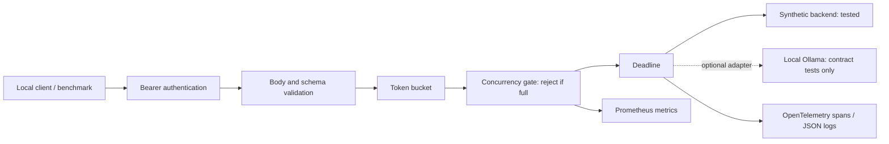
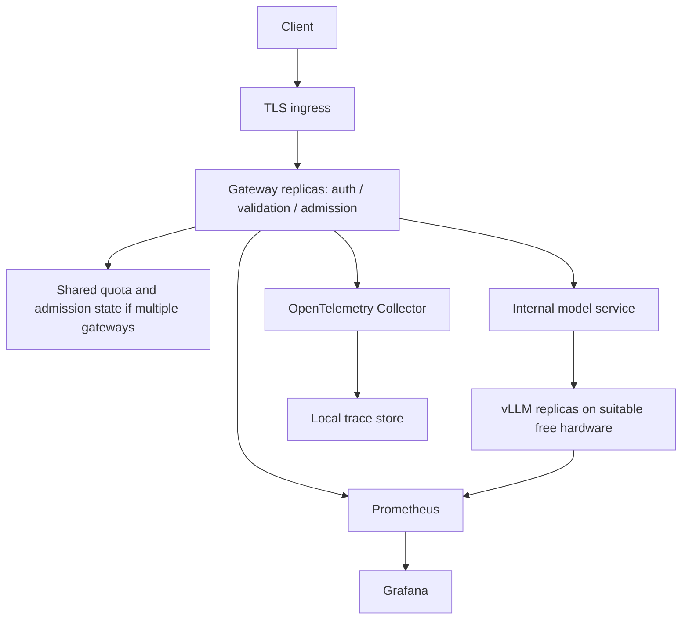

# Architecture and technology decisions

## Implemented local path

Requests are admitted only after authentication and validation. There is no application wait queue: capacity exhaustion returns 503 immediately; a depleted rate bucket returns 429. Backend errors return 502 and deadlines return 504. `Retry-After` is guidance, not a reservation. Capacity is released in a `finally` block, including cancellation of an in-process request task.

One gateway process owns one token bucket and concurrency counter. This is intentionally **not a distributed quota system**. Increasing workers or replicas would multiply the permitted load. One configured bearer token represents one local caller identity; multi-user authorization is out of scope for this milestone.

## Target model-serving architecture — not deployed

Kubernetes will provide deployment, health probes, resource requests/limits, service discovery, and network policy. A local cluster is the first deployment target. The current adapter deliberately rejects non-loopback endpoints; cluster connectivity will require an explicit, tested configuration change and egress policy. No cloud resource definitions or provisioning commands are included.

Each GPU serving replica loads its own model and consumes its own capacity. Horizontal scaling will be investigated only with available hardware and supported metrics; it is not enabled merely by increasing a YAML replica count. Candidate signals are queue depth, active sequences, and serving latency. Gateway CPU scaling alone does not create inference capacity. Scale-out tests must address cold loading, readiness, graceful draining, and the interaction with shared admission state.

## Decisions

| Choice | Reason | Tradeoff / verification |
|---|---|---|
| Python 3.12, FastAPI, HTTPX | Async request handling, typed validation, transport substitution for tests | A Python gateway has overhead; measure it separately from inference |
| Synthetic backend first | Deterministic failures and bounded, inexpensive tests | Cannot measure token throughput, model quality, or GPU behavior |
| Ollama adapter for local development | Existing local installation; compatible chat API | Local model still unverified; cloud routing must be rejected |
| vLLM as target serving engine | Separates inference scheduling from gateway policy; compatible chat API | Requires a separate compatibility and hardware-validation milestone |
| No queue at the gateway | Bounded admitted work and explicit overload behavior | Bursts are rejected; clients need bounded backoff |
| Static bearer token for local use | Small, testable authentication boundary | No rotation service, OAuth/OIDC, user mapping, or revocation system |
| Prometheus client | Standard counters, gauges, and histograms | No scraping server or dashboard is installed yet |
| OpenTelemetry SDK | Request/backend parent-child spans and trace propagation | JSON export only; remote backend spans and collector export are not verified |
| One worker | Correct local admission accounting without shared state | Not suitable for horizontal scaling as implemented |
| Exact dependency pins | Captures the tested environment | Pins need maintenance and vulnerability review; not a security guarantee |

## Telemetry contract

Metrics count status codes using a fixed route allowlist. Arbitrary paths, model names, trace IDs, prompt content, and bearer tokens are never metric labels. Duration histograms measure gateway HTTP handling, not time to first token. Backend type and HTTP status are the only span attributes currently recorded.

The gateway creates its own trace context and forwards W3C `traceparent` to the local adapter. It does not trust client-supplied tracing metadata. The backend adapter test verifies the header; a real backend tracing integration is a later milestone. Synthetic backend and gateway spans are in the same process, not proof of distributed trace collection.

## API boundaries

Only text messages with system/user/assistant roles are accepted. Streaming, tools, image inputs, extra request fields, and other models are rejected. Bodies are limited to 16 KiB, individual messages to 8,192 characters, messages per request to 32, and requested output tokens to 256. These are request limits, not a tokenizer-aware context-budget calculation. The synthetic backend supplies no invented token-usage figures.

`/healthz` is process liveness, not model readiness. A proper model-readiness gate will be required before Kubernetes traffic routing.

## Sources

- [Ollama chat API compatibility](https://docs.ollama.com/api/openai-compatibility) — confirms the local chat endpoint and that a local server can route cloud models.
- [vLLM serving documentation](https://docs.vllm.ai/en/latest/serving/openai_compatible_server/) — reference for the future backend contract.
- [vLLM installation guidance](https://docs.vllm.ai/en/latest/getting_started/installation/cpu/) — hardware support must be checked for the chosen backend and version.

These references guide interoperability; implementation code in this project was written independently.
